# User guide

This guide walks through Senario Manager tab by tab, then covers the features that cut across
tabs: pace, follow-ups, attachments, the operating year and scenario files.

- [The window](#the-window)
- [Starting from a template](#starting-from-a-template)
- [Company](#company)
- [Customers](#customers)
- [Parties](#parties)
- [Settings](#settings)
- [Running a scenario](#running-a-scenario)
- [Activity](#activity)
- [Conversations](#conversations)
- [Injects](#injects)
- [Outbox](#outbox)
- [Report](#report)
- [How realistic it gets](#how-realistic-it-gets)
- [Pace](#pace)
- [Follow-ups](#follow-ups)
- [Email format](#email-format)
- [Attachments](#attachments)
- [Operating year](#operating-year)
- [Saving, opening and auto-save](#saving-opening-and-auto-save)
- [Updates](#updates)
- [Tips for a convincing scenario](#tips-for-a-convincing-scenario)

## The window

The sidebar is always visible. From top to bottom:

- **File:** the open `.senario` file, auto-save status, and **New / Open / Save / Save as**.
- **Tabs:** set-up tabs (Company, Customers, Parties, Injects, Settings), then run-time tabs
  (Activity, Conversations, Outbox, Report). Outbox shows a count of emails waiting for review.
- **Scenario date:** shown when the company has an [operating year](#operating-year).
- **Listening:** whether the reply listener is up, and on which address and port.
- **Running / Stopped:** the scenario state, the [exercise clock](#injects) (`T+1:36`), the time
  of the next new email, and how many replies and chases are queued.
- **Customer pace:** the [pace slider](#pace).
- **Start / Stop scenario** (green / red).

## Starting from a template

Click **New** (**Ctrl+N**) to start from a ready-made scenario, or from a blank one.

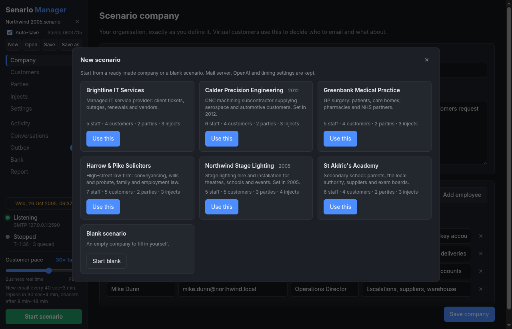

| Template | Company | Year |
|---|---|---|
| Brightline IT Services | Managed IT service provider: tickets, outages, a phishing scare | present |
| Calder Precision Engineering | CNC machining subcontractor: late orders, non-conformances, price-downs | 2012 |
| Greenbank Medical Practice | GP surgery: prescriptions, care homes, a failing phone system | present |
| Harrow & Pike Solicitors | High-street law firm: delayed completions, client account checks | present |
| Northwind Stage Lighting | Lighting hire: quotes, faults, invoice disputes | 2005 |
| St Aldric's Academy | Secondary school: parents, trips, a new payment system | present |

Each one has employees, customers (including organisations with more than one contact),
external parties and a few example [injects](#injects). Edit anything you like.

The new scenario is **unsaved**. The previously open `.senario` file keeps its last saved state
and is never overwritten. Mail server, OpenAI and timing settings carry over.

## Company

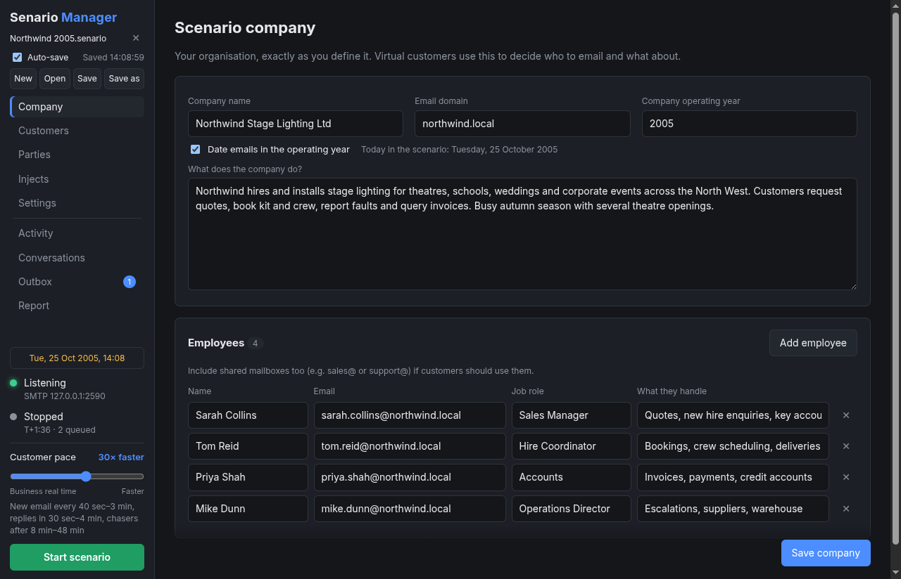

Everything about your organisation is defined here by you. The app never invents employees.

| Field | What it's for |
|---|---|
| **Company name** | Used in every AI prompt. |
| **Email domain** | The company's domain, e.g. `northwind.local`. Customers only ever send to this domain. |
| **Company operating year** | Optional. Runs the scenario in a past (or future) year. See [Operating year](#operating-year). |
| **Date emails in the operating year** | Puts the scenario-year date in email `Date:` headers. |
| **What does the company do?** | The single most important input. Customers decide what to email about based on it, so be specific: products, typical customers, current projects, recent problems. |
| **Employees** | Name, email, job role and *what they handle*. Customers choose who to write to from these, so "Invoices, payments, credit accounts" routes billing questions to the right person. |

Add shared mailboxes (`sales@`, `support@`, `accounts@`) as employees too if customers should
use them. Click **Save company** when done.

## Customers

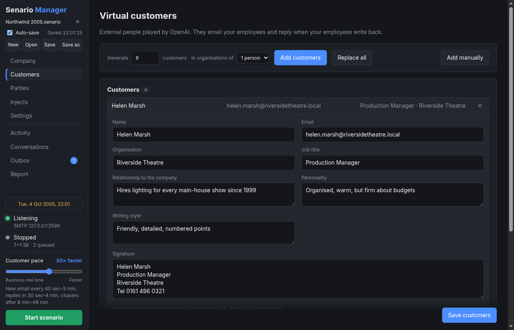

Customers are the people who start conversations. They're played by OpenAI.

- **Add customers** generates the number you choose from your company description, avoiding
  duplicates of existing customers. **Replace all** starts over.
- Each customer has a name, email, organisation, job title, relationship to the company,
  personality, writing style and signature. All of it is editable. Click a customer to expand it.
- **Add manually** creates a blank customer.
- **In organisations of up to 2 / 3** generates several contacts per organisation, sharing a
  domain, such as a buyer and their manager. See [colleagues](#colleagues-and-escalation).
- **Remembers about the company** is the customer's [memory](#memory) of earlier dealings. It's
  filled in automatically as conversations happen, and you can edit it.
- Click **Save customers** after editing.

Customer email domains use the fictional TLD set in **Settings → Scenario behaviour** (`.local`
by default), so they never belong to a real organisation. Each customer domain needs a route
on your mail server. See [Mail server setup](mail-server-setup.md).

> Set the [operating year](#operating-year) *before* generating customers, so their histories
> and signatures fit the period.

## Parties

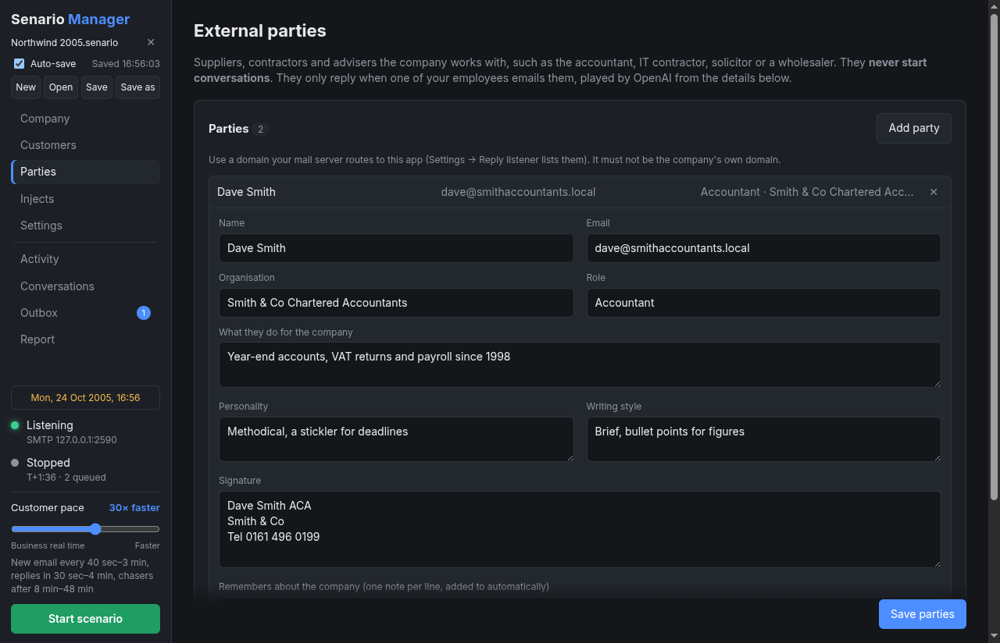

External parties are suppliers, contractors and advisers the company works with, such as an
accountant, IT contractor, solicitor or wholesaler. Unlike customers:

- **You define them.** Nothing is generated.
- **They never start a conversation.** They're never picked for scheduled emails or *Send an email now*.
- **They reply when an employee emails them**, as a supplier whose client is the company. The
  accountant answers the VAT question with figures, asks for the bank statement they need, and
  stays within their remit.
- They don't chase unanswered questions unless you enable that under **Settings → Follow-ups**.

Fields: name, email, organisation, role, **what they do for the company** (the most important
one), personality, writing style and signature. Party domains need mail-server routes just like
customer domains, and can't be the company's own domain.

## Settings

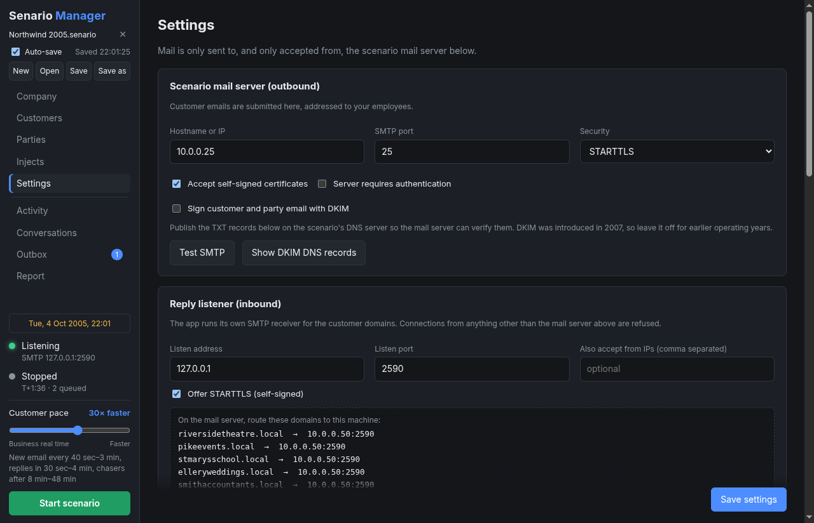

Settings has five sections:

- **Scenario mail server (outbound):** where customer emails are submitted. Use **Test SMTP** to
  check the connection.
- **Reply listener (inbound):** the app's own SMTP receiver. The box at the bottom lists exactly
  which domains to route to which address. See [Mail server setup](mail-server-setup.md).
- **OpenAI:** API key, model and an optional base URL. Use **Test OpenAI** to check it.
- **Scenario behaviour:** the customer TLD, extra guidance for the AI, timing and working hours.
- **Follow-ups:** chasing unanswered emails.

Every setting is described in the [settings reference](configuration.md). Click **Save settings**
after changes. Changing the listener address or port, or the mail server, restarts the listener
straight away.

### Extra guidance

**Settings → Scenario behaviour → Extra guidance** is free text passed to every customer and
party. Use it to steer the scenario, for example:

- *"A product recall is under way this week; several customers are unhappy about late deliveries."*
- *"Keep emails short; most customers write from their BlackBerry."*
- *"One customer, Gary Pike, is disputing invoice INV-2207."*

## Running a scenario

Click **Start scenario**. The app then:

1. Sends a new customer email after a random interval (*New customer email every … to …*),
   repeating until stopped.
2. Answers every reply from an employee after a random delay (*Customer reply delay*).
3. Chases unanswered emails if [follow-ups](#follow-ups) are on.

Click **Stop scenario** to pause. While stopped:

- **The listener keeps running**, so the mail server can still deliver replies. Replies received
  while stopped are answered once you start again.
- Queued replies and chases are kept, including across app restarts, and resume on the next start.

Quitting the app closes the listener. The app asks you to confirm, because the mail server then
holds replies until the app is back.

## Activity

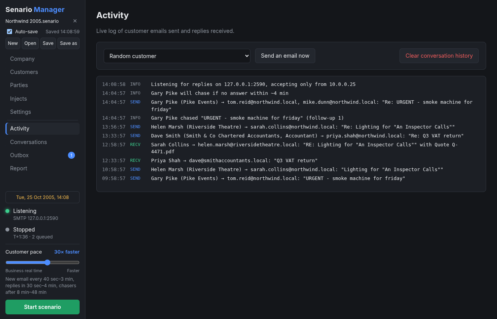

A live log of everything the app does:

| Level | Meaning |
|---|---|
| `SEND` | A customer or party email was submitted to the mail server. |
| `RECV` | An email from the company arrived at the listener, including attachment names. |
| `INFO` | Scheduling, decisions ("considers the thread finished"), listener status. |
| `ERROR` | Something failed: SMTP, OpenAI, a refused connection, an unreadable attachment. |

**Send an email now** triggers a new customer email immediately, from a random customer or the
one you pick. **Clear conversation history** forgets all threads and queued replies. It doesn't
touch mail already delivered.

The log is kept in the `.senario` file (last 5,000 entries). Times here are always real-world
time.

## Conversations

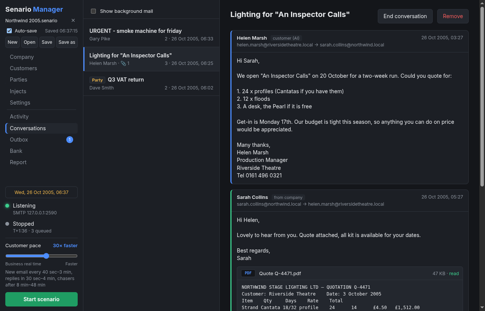

Every thread, newest first. Threads with external parties are tagged **Party**, and 📎 shows the
number of attachments.

- Blue-edged messages were written by the app (*customer (AI)*). Green-edged messages came from
  the company.
- Attachments are listed under their message with type, size and whether they were read. Click
  one to see exactly what the AI read from it.
- Dates are shown in the scenario's operating year.

Replies are matched to threads by their `In-Reply-To`/`References` headers. If a mail client
drops those, the reply is matched by subject and customer instead.

## Injects

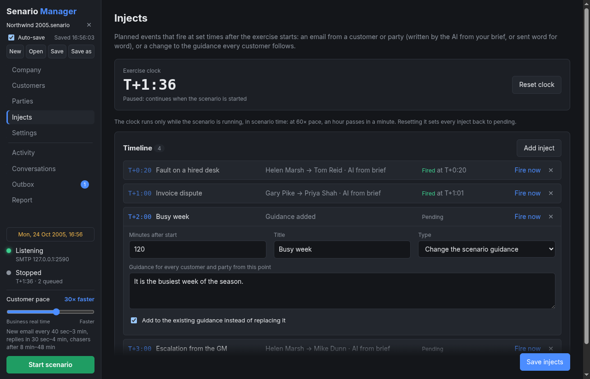

Injects are planned events on a timeline: what an exercise organiser would call a *master
scenario events list*. Each one fires at a set time after the exercise starts.

- **Email from a customer or party**, either:
  - **written by the AI from a brief:** *"Complain that the delivery for order 4471 never
    arrived and ask for a refund."* The customer writes it in their own voice, consistent
    with past conversations, or
  - **sent exactly as typed**, with your own subject and message.

  Tick recipients, or leave them all unticked to let the AI pick the right person. Tick
  *Waiting for an answer* if the sender should chase it.
- **Change the scenario guidance**, replacing or adding to the [extra guidance](#extra-guidance)
  every customer follows from then on. For example: *"A product recall is under way."*

**The exercise clock** (`T+h:mm`) starts the first time you click **Start scenario**. It pauses
when you stop, and runs in scenario time, so at 60× pace an hour passes in a minute. Each
inject fires once its time is reached, then shows *Fired at T+…*. A failed inject shows the
error; hover over *Failed* to read it.

- **Fire now** sends an inject immediately, whatever its time.
- **Reset clock** returns the clock to `T+0:00` and sets every inject back to pending, ready to
  rerun the exercise.
- Click **Save injects** after editing. Injects are saved in `.senario` files and templates.

Injects are never held in the [Outbox](#outbox), because they're already planned.

## Outbox

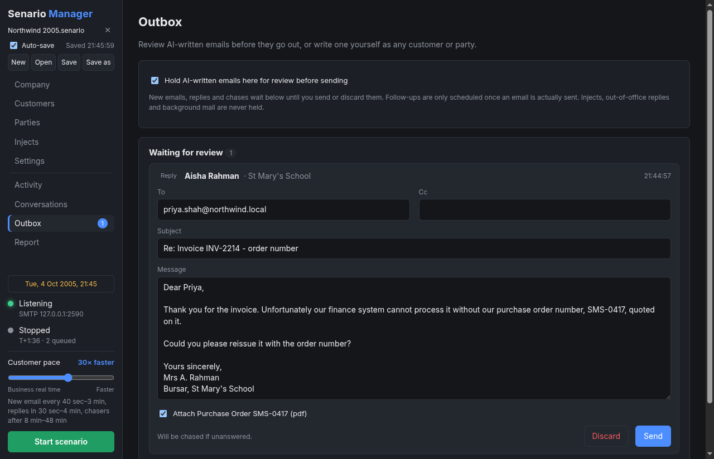

Tick **Hold AI-written emails here for review** to approve every new email, reply and chase
before it goes out. For each draft you can:

- change the recipients, subject or message
- leave out its attached document or meeting invitation
- **Send** or **Discard** it

Follow-ups are only scheduled once an email is actually sent. Injects, out-of-office replies and
background mail are never held.

**Write an email** lets you send a message yourself as any customer or party: start a new
conversation, or reply in an existing one, quoted like a normal reply. It always goes
straight out. Tick *Waiting for an answer* if the sender should chase it.

## Report

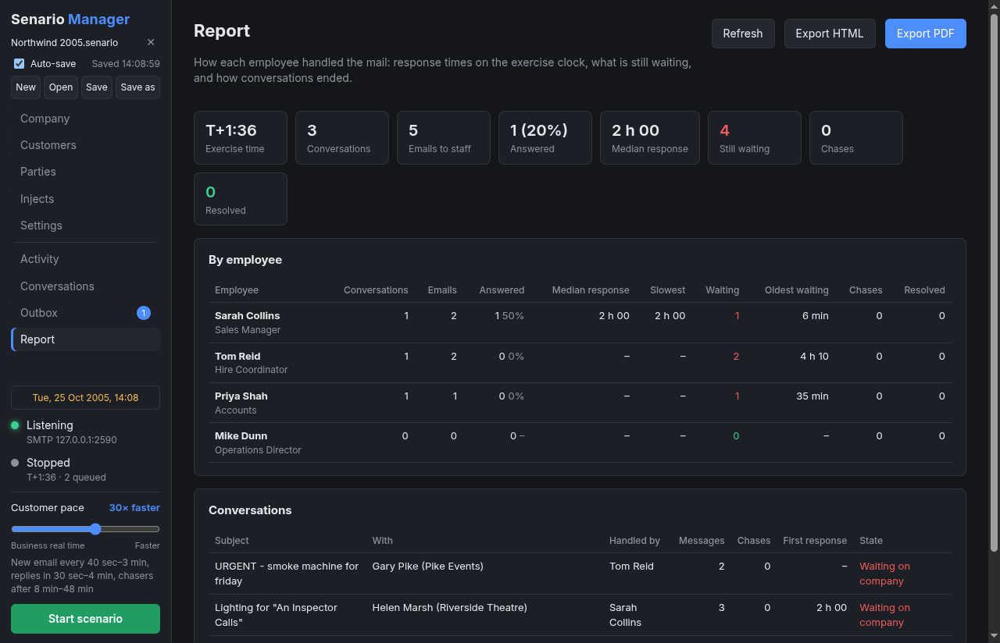

How each employee handled the mail sent to them:

| Column | Meaning |
|---|---|
| Emails | Customer and party emails addressed to them |
| Answered | How many they replied to |
| Median / slowest response | Time from the email to their reply, on the exercise clock |
| Waiting / oldest waiting | Emails nobody at the company has answered yet, and the oldest one's age |
| Chases | Follow-ups their silence caused |
| Resolved | Conversations they handled that ended with the customer satisfied |

The conversation table shows who handled each thread, its first response time, and whether it's
resolved or waiting on the company or the customer. Background mail isn't included.

Times are measured in scenario time: a reply that took 2 real minutes at 60× pace counts as
2 hours. **Export HTML** saves a self-contained page, and **Export PDF** a landscape A4 PDF, for
the debrief.

## How realistic it gets

### Documents and meeting invitations

Customers and parties sometimes attach a document when a real person would: a purchase order,
remittance advice, specification, signed form, price list or statement. It's a genuine file in
the format of the [operating year](#operating-year):

| Type | Before 2007 | From 2007 |
|---|---|---|
| Word | `.doc` (RTF content, opens in Word) | `.docx` |
| Excel | `.xls` | `.xlsx` |
| PDF | `.pdf` | `.pdf` |

When proposing a meeting at a specific time, they send a real **calendar invitation**, which
shows as an Accept/Decline invite in Outlook and other clients. If an employee accepts, no
reply is needed. If they decline, the customer answers. Both are shown in Conversations, and
you can **Save** any generated document from there. Switch either off under **Settings →
Scenario behaviour**.

### Colleagues and escalation

Customers at the same organisation (the same email domain) know each other. They copy each other
in where natural, and on the second chase a more senior colleague may take over: *"I'm
writing as Helen's manager…"*, copying the original sender. Employees can reply to either.

### Memory

After each email a customer or party may note something worth remembering, such as *"Asked
for all deliveries before 9am"* or *"Delivery for Blithe Spirit arrived two hours late"*. It's
dated in the scenario year, fed into every later email they write, and editable on the Customers
and Parties tabs (last 10 notes).

### Out-of-office replies

With a small chance (**Settings → Scenario behaviour → Out-of-office chance**, 3% by default), a
customer is away. An automatic reply goes out straight away, naming a colleague if they have
one, in the style of their mail program: *"Out of Office AutoReply:"* in Outlook 2003-era
scenarios, *"Automatic reply:"* later. Their real reply comes a few days later.

### Background mail

Real inboxes are mostly mail nobody answers. With **Settings → Background mail** on, employees
also receive trade newsletters, supplier offers, order and delivery notifications, statements and
system alerts, every 45–180 minutes by default. These come from fictional senders on the customer
TLD, with proper bulk-mail headers (`Precedence: bulk`, `List-Unsubscribe`, `Auto-Submitted`), and
newsletters use a branded HTML layout. They're never chased, and are hidden in Conversations unless
you tick *Show background mail*. **Send one now** sends one immediately.

### Mail headers

Each customer and party has their own mail program, fixed for that person and fitting the year:

- **2005:** Outlook 2003 and XP, Outlook Express, Thunderbird 1.0, Apple Mail, Lotus Notes or a
  BlackBerry
- **Today:** current Outlook, webmail, Apple Mail, iPhone or Thunderbird

That decides the `X-Mailer`/`User-Agent` header, the shape of the `Message-ID`, Outlook's
`Thread-Index`/`Thread-Topic`, *"Sent from my iPhone"* style sign-offs, and the quoting style.
`Date:` headers carry the sender's local time zone offset.

**DKIM:** tick **Settings → Scenario mail server → Sign customer and party email with DKIM**.
The app generates a key for each customer and party domain, and **Show DKIM DNS records**
lists the TXT records to publish on the scenario's DNS server. DKIM was introduced in 2007, so
leave it off for earlier years.

## Pace

The **Customer pace** slider compresses every delay: new emails, customer replies and chases.

| Position | Effect |
|---|---|
| **Business real time** (1×) | Timings exactly as set in Settings. |
| 2×, 5×, 10×, 30×, 60×, 120× | Everything that many times faster. At 60×, an hour of scenario time passes in a minute. |
| 360× (far right) | An hour passes in 10 seconds. Good for demos and testing. |

The line under the slider shows the effective timings. Changing pace while running rescales
everything already scheduled, so a reply due in an hour at 1× is due in a minute after moving to
60×. Working-hours limits only apply at real-time pace.

## Follow-ups

If nobody answers a customer's email, the customer chases it after a random wait (**Settings →
Follow-ups**, 4–24 hours of scenario time by default, at most 2 chases per email).

1. The first chase is a polite nudge.
2. The second is noticeably firmer and mentions the impact of the delay.
3. Later chases escalate and may copy in another member of staff.

Each chase waits a little longer than the one before. Any reply from the company cancels pending
chases on that thread. Customers don't chase when they aren't waiting for anything, for example
after their own "thanks, all sorted".

## Email format

By default, emails are sent as **HTML with a plain-text copy** (`multipart/alternative`), the
way Outlook, Gmail and Apple Mail send them. Mail clients show the HTML, and anything text-only
falls back to the copy. Switch to *Plain text only* under **Settings → Scenario behaviour →
Email format**.

The HTML is built by the app from the AI's text, never written by the AI, and everything is
escaped. To make the inbox look like many different people with different mail clients:

- **Each customer and party has a consistent font.** It's picked from fonts that existed in the
  [operating year](#operating-year). A 2005 scenario uses Arial, Tahoma, Verdana, Times New Roman
  and Trebuchet MS; Calibri only appears from 2007, Aptos from 2023.
- **Lists:** lines starting with `-` or `1.` become real bulleted or numbered lists.
- **Replies quote the earlier message** in one of two styles, again fixed per sender:
  Outlook's *From / Sent / To / Subject* block under a blue rule (with `-----Original
  Message-----` in the text copy), or *"On …, … wrote:"* with an indented quote.

## Attachments

When an email from the company has attachments, the app extracts their text and gives it to the
customer or party, who then reacts to the specifics: prices, line items, dates and terms.

| Type | Formats |
|---|---|
| PDF | `.pdf` (text-based; scanned PDFs have no text to read) |
| Word | `.docx`, `.doc` (tables keep one row per line) |
| Spreadsheets | `.xlsx`, `.xls`, `.xlsb`, `.ods`, `.csv` (every sheet) |
| Presentations | `.pptx`, `.odp` |
| Other documents | `.odt`, `.rtf`, `.html`, `.txt`, `.md`, `.json`, `.xml`, `.ics`, `.vcf` |
| Email | Forwarded `.eml` messages |
| Images | `.png`, `.jpg`, `.gif`, `.webp`, transcribed by the OpenAI model (needs a model that accepts images) |

- Signature logos embedded in the email body are ignored.
- If a file can't be read (scanned, corrupt, unsupported or over 25 MB), the customer reacts as a
  real person would, typically by asking for it to be resent.
- Up to 20,000 characters are kept per attachment. The extracted text is kept, not the file.
- Files are parsed in an isolated worker with a 30-second limit, so a malformed file can't stall
  the app.

Customers and parties never send attachments themselves. They put the details in the email body.

## Operating year

Set **Company → Company operating year** (e.g. `2005`) to run the scenario in that year.

- **Scenario clock:** real time is shifted back by whole weeks, so weekdays and times of day
  always match the real clock. Tuesday 6 October 2026, 10:30 becomes Tuesday 4 October 2005,
  10:30. The sidebar shows the current scenario date.
- **Period-correct content:** customers and parties live in that year. Technology (fax,
  landlines, period mobiles), file formats, prices, laws, events and companies must fit it, with
  nothing from later.
- **Email dates:** with *Date emails in the operating year* ticked, `Date:` headers and the
  *"On … wrote:"* lines in replies use the scenario date. Untick it to keep real dates in headers;
  the content still follows the year.
- Leave the field empty for the present day.

> The mail server adds its own `Received:` headers using its own clock, which the app can't
> change. If lab machines' clocks are set to the scenario year too, that's fine: the app records
> when each reply actually arrived, so ordering and delays aren't affected.

## Saving, opening and auto-save

Use **Open / Save / Save as** at the top of the sidebar (**Ctrl+O**, **Ctrl+S**,
**Ctrl+Shift+S**; **⌘** on macOS). A `.senario` file holds everything: settings, company,
customers, parties, conversations, queued replies and chases, and the activity log.

- **Save** first commits whatever is in the forms, so the file matches what's on screen.
- On **Save as** you choose whether to include credentials (OpenAI key and SMTP password). Leave
  them out for files you'll share. Opening a file without credentials keeps the ones already in
  the app.
- **Auto-save:** once a scenario is saved to or opened from a file, every change is written back
  to it: about 1.5 seconds after things go quiet, at least every 10 seconds while busy, and on
  quit. The sidebar shows the last save time, or **Save failed** if, for example, a USB drive was
  removed. The **Auto-save** checkbox turns it off, and **✕** stops using the file.
- Queued replies and chases keep the time they had left, so a loaded scenario resumes where it
  was saved.
- Opening a file asks before replacing the current scenario, and stops it if it's running.
- Double-clicking a `.senario` file opens it in the app (installed builds).

The format is plain SQLite. See [.senario files](senario-file-format.md).

## Updates

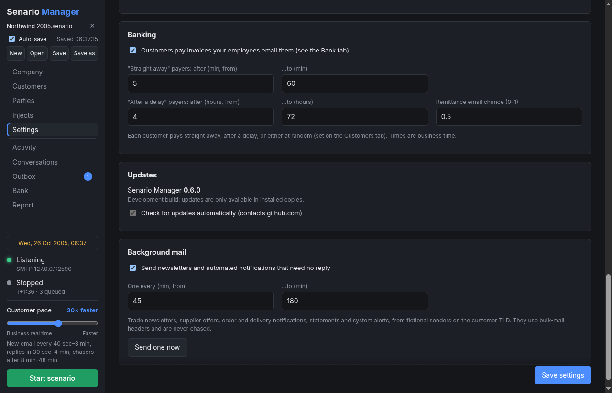

Installed copies check GitHub for new versions 15 seconds after start-up, then every 6 hours.
When one is published:

- **Windows installer, Linux AppImage, .deb and .rpm, and signed macOS builds:** it downloads
  in the background. A blue **Update ready: restart to install** banner appears in the sidebar,
  and the update installs the next time the app restarts, or straight away with **Settings →
  Updates → Restart and install**. The app never restarts by itself, so a running exercise is
  never interrupted. Installing stops the scenario cleanly; queued replies and the exercise clock
  resume when you start again. `.deb`/`.rpm` installs ask for an administrator password.
- **Windows portable `.exe` and unsigned macOS builds:** these can't replace themselves, so the
  banner says a new version is available and **Open download page** takes you to it.

Untick **Check for updates automatically** to stop the app contacting github.com, for example on
an isolated network. **Check now** still works on demand. Without internet access the check
fails quietly, with one line in the Activity log. The setting belongs to this installation and is
not stored in `.senario` files.

## Tips for a convincing scenario

- **Write a rich company description.** Mention products, prices, current projects, recent
  incidents and the kind of customers you have. The more context, the more specific the emails.
- **Give employees clear "what they handle" entries**, so customers reach the right person.
- **Edit customers' personalities.** One impatient customer, one meticulous one and one chatty one
  make the inbox feel alive.
- **Start at a higher pace** to seed some history, then drop to real time for the exercise.
- **Use extra guidance** to inject events mid-exercise ("a delivery van broke down this morning").
- **Save a clean starting point** as a `.senario` file and reload it to rerun the same exercise.
- **Plan the key moments as injects**, and let random traffic fill the gaps between them.
- **Turn on review** for your first run, to see what the AI writes before trainees do.
